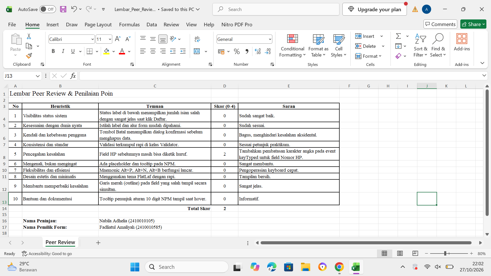
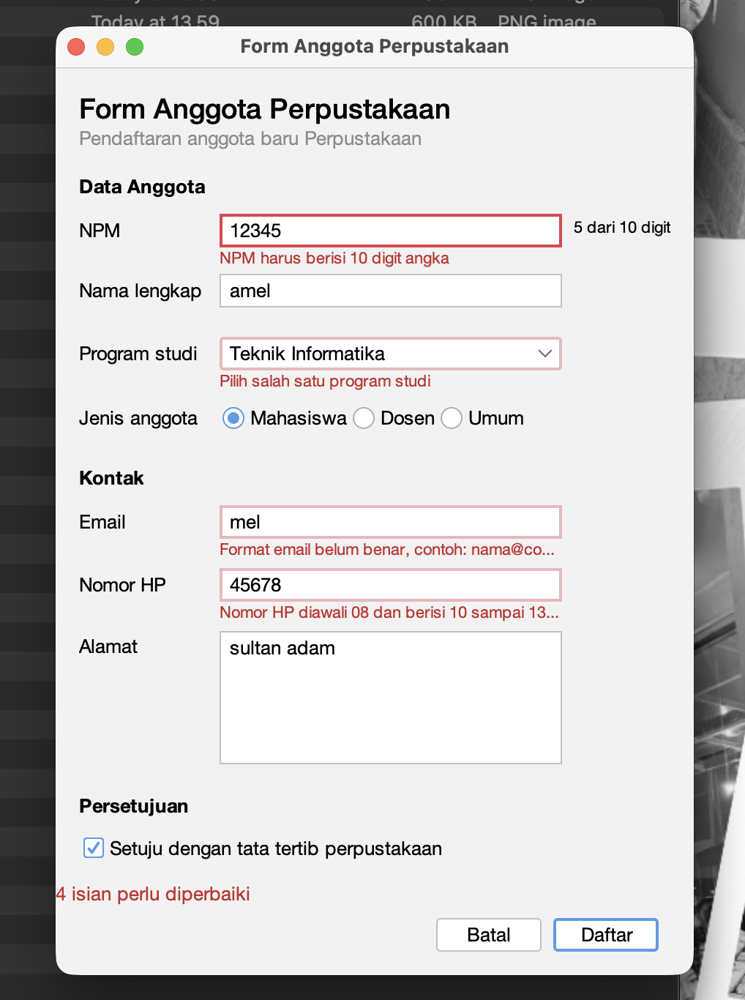
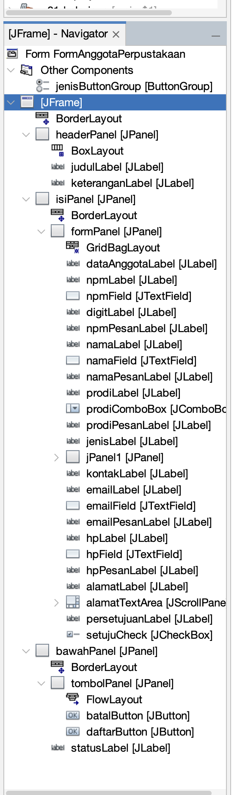

# P06 – Validasi Input dan Kegunaan (`p06-validasi-input`)

Proyek Java Swing (NetBeans) berisi `FormAnggotaPerpustakaan` yang sudah dilengkapi validasi input, umpan balik pesan kesalahan, dan aspek kegunaan (mnemonic, fokus otomatis, konfirmasi batal).

**Nama:** Fadliatul Amaliyah
**NPM:** 2410010585
**Mata Kuliah:** Pemrograman Berorientasi Objek 2

## Isi Proyek

| File | Keterangan |
|------|------------|
| `FormAnggotaPerpustakaan.java` | Kode form beserta logika validasi |
| `FormAnggotaPerpustakaan.form` | Desain GUI (NetBeans GUI Builder) |

---

## 1. Lembar Peer Review dari Teman

---

## 2. Tabel Temuan Teman, Perbaikan, dan Commit

| No | Temuan dari Teman | Perbaikan yang Dilakukan | Commit Git yang Memuat Perbaikan |
|----|-------------------|--------------------------|----------------------------------|
| 1 | Field Nomor HP masih bisa diinput huruf/karakter bukan angka. | Menambahkan listener `hpFieldKeyTyped` yang memanggil `evt.consume()` jika karakter yang diketik bukan angka atau panjang sudah melebihi 13 digit. | `fix: batasi input nomor hp hanya angka pada event keyTyped` |
| 2 | Validasi nama belum memeriksa angka (misal "Amel123" lolos). | Menambahkan aturan regex `.*\\d.*` pada method `Validator.nama()` agar nama yang mengandung angka ditolak. | `feat: tambah aturan validasi nama tidak boleh mengandung angka` |

---

## 3. Tangkapan Layar Form dengan Pesan Kesalahan

---

## 4. Tangkapan Layar Jendela Navigator (Label Pesan)

---

## 5. Jawaban Eksperimen Praktikum 4

**1. Ketik huruf pada isian NPM. Apa yang terjadi dan baris mana di `npmFieldKeyTyped` yang menyebabkannya?**

Huruf tidak muncul di isian. Di dalam method `npmFieldKeyTyped`, ada pemeriksaan karakter yang membuang (mengabaikan) event tombol jika karakter yang ditekan bukan digit angka, sehingga hanya angka yang bisa masuk.

**2. Isi email dengan `siti@`, lalu tekan Tab. Kapan pesan kesalahan muncul?**

Pesan kesalahan *"Format email belum benar, contoh: nama@contoh.com"* langsung muncul di bawah field email, dengan garis tepi merah, tepat saat fokus berpindah (event *focus lost*).

**3. Klik isian Nama tanpa mengetik, lalu tekan Tab. Mengapa tidak ada pesan kesalahan?**

Karena method `namaFieldFocusLost` memiliki kondisi `if (!namaField.getText().isBlank())`, sehingga validasi umpan balik saat berpindah fokus hanya berjalan jika isian tidak kosong. Isian yang kosong baru diperiksa saat tombol **Daftar** diklik.

**4. Centang persetujuan, lalu klik Daftar dengan form kosong. Isian mana yang mendapat fokus?**

Muncul pesan status di bawah panel *"5 isian perlu diperbaiki"*, garis merah muncul pada semua isian wajib, dan kursor fokus otomatis diarahkan ke **`npmField`** (isian pertama yang salah).

**5. Tekan tombol Alt bersama huruf N. Isian mana yang mendapat fokus, dan properti apa yang mengaturnya?**

Kursor langsung berpindah ke **`namaField`**. Ini diatur oleh properti `displayedMnemonic` yang diisi huruf `N` pada `namaLabel`, serta properti `labelFor` yang menghubungkan label tersebut ke `namaField`.

**6. Isi beberapa isian, lalu klik Batal dan pilih No. Apakah data tetap ada?**

Ya, data tetap ada. Memilih **No** pada dialog konfirmasi hanya menutup dialog tanpa mereset isian form.

---

## 6. Deklarasi Penggunaan AI

Saya menggunakan **Gemini AI** untuk membantu memahami materi modul (konsep validasi input, penanganan event `keyTyped` dan `focusLost`, serta penggunaan mnemonic). Seluruh kode, pengujian, dan jawaban eksperimen saya tulis dan verifikasi sendiri.
